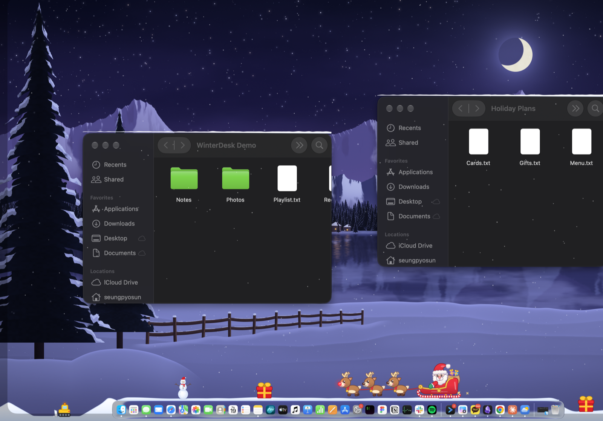
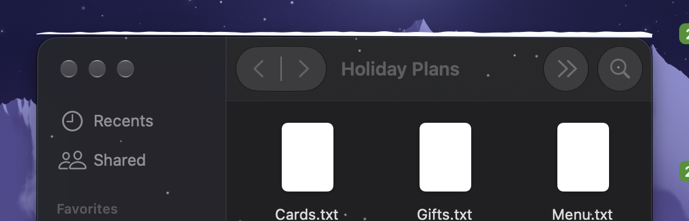
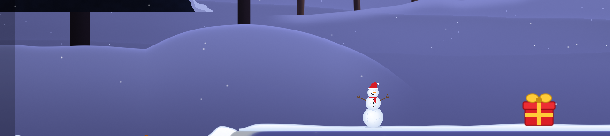

# WinterDesk ❄️

맥 바탕화면에 겨울을 입히는 메뉴바 앱입니다.
눈이 내려 창 위와 Dock 위에 쌓이고, 눈을 굴려 눈사람을 만들고, 산타가 썰매를 타고 날아와 선물을 떨어뜨립니다.
모든 그래픽은 외부 이미지 없이 코드로 그립니다 (Swift · SpriteKit · Core Graphics).



---

## 어떤 효과가 있나요?

### 1. 창 위에 쌓이는 눈
열려 있는 앱 창의 윗변마다 얇은 눈이 쌓입니다. 창을 움직이면 눈이 창에 딱 붙어 부드럽게 따라옵니다.



- 눈은 **모래처럼** 움직입니다. 양은 일정하게 유지되고, 창을 넓히면 넓어진 쪽으로 밀려가고, 좁히면 남는 눈이 가장자리로 흘러내립니다.
- 창을 빠르게 끌면 눈이 뒤쪽으로 미끄러져 떨어지고, 세게 던지듯 흔들면 눈가루가 흩날립니다.
- 창을 최소화(노란 − 버튼)하거나 숨기면(⌘H) 그 창의 눈은 바로 사라지고, 창을 다시 열면 다시 쌓입니다.
- 앞에 있는 창에 가려진 부분은 그리지 않고, 클릭은 가로채지 않습니다.

### 2. 바닥과 Dock 위의 눈, 눈사람, 선물
화면 아래쪽 전체에 눈이 쌓이고, Dock 위에도 얇게 눈이 덮입니다. Dock 아래 빈 곳까지 눈이 이어집니다.



- **눈사람 만들기**: Dock 위(또는 바닥) 눈을 클릭하고 좌우로 끌면 눈덩이가 굴러가며 커집니다. 작은 눈덩이를 큰 눈덩이 위에 놓으면 쌓입니다(최대 3단).
- **눈사람 꾸미기**: 2단 이상 눈사람을 클릭하면 꾸미기 패널(*Fashion week, but colder.*)이 열립니다. 모자·얼굴·몸·옷을 고를 수 있습니다.
- **눈사람/눈덩이 지우기**: 마우스를 잠깐 올려 두면 나타나는 ✕를 누르거나, 오른쪽 클릭 → 삭제.
- **창 위 눈사람**: 눈사람을 창 윗변에 올려 두면 그 창을 타고 함께 다닙니다.
- **선물 상자**: 기본으로 하나가 놓여 있고, 산타가 지나갈 때 가끔 하나씩 떨어뜨려 계속 쌓입니다. 끌어서 던질 수 있습니다.
- **장난감 제설차**: 노란 제설차가 바닥 눈 위를 달리며 눈을 밀어 작은 더미를 만듭니다. 클릭하면 경광등이 켜집니다.

### 3. 산타와 순록
산타가 순록 3마리가 끄는 썰매를 타고 가끔 하늘을 가로질러 날아갑니다. 눈을 깜빡이고 손을 흔들며, 때때로 Dock 위에 내려앉아 미끄러지다 다시 날아오릅니다.


- 산타를 클릭하면 "Ho Ho Ho!" 하며 선물을 떨어뜨립니다.
- 맨 앞 순록의 빨간 코가 빛나고, 썰매 뒤로 반짝이 꼬리가 남습니다.

### 4. 창과 창 사이 전구
- 창 윗변에 전구 가랜드가 걸리고, 가까운 창끼리는 전구 줄이 자동으로 이어집니다.
- **직접 연결하기**: ⌃⌥⌘L(또는 메뉴 "전구 연결하기…")을 누르면 창마다 금색 점이 나타납니다. 한 창의 점을 다른 창의 점으로 끌어다 놓으면 전구 줄이 생깁니다. 편집 중 줄을 클릭하면 지워지고, Esc로 끝냅니다.

### 5. 겨울 배경화면
코드로 직접 그린 겨울 밤 배경화면이 함께 들어 있습니다 (`wallpaper/winter-night.png`).


---

## 설치 방법

### 준비물
- macOS 13 이상 (Apple Silicon / Intel)
- Command Line Tools (Xcode 전체는 필요 없음). 없다면 터미널에서:
  ```bash
  xcode-select --install
  ```

### 설치
```bash
git clone https://github.com/sitdownSeungpyo/mac_snow.git
cd mac_snow
./install.sh
```

`install.sh`는 앱을 빌드해서 `~/Applications/WinterDesk.app`에 설치하고 바로 실행합니다.
설치된 앱은 처음 실행할 때 **로그인 시 자동 실행**이 켜지므로, 맥을 켤 때마다 자동으로 시작됩니다.

> 빌드만 하고 싶다면 `./build.sh` → `build/WinterDesk.app`이 만들어집니다.

### 배경화면 적용 (선택)
```bash
./wallpaper/set_wallpaper.sh       # 겨울 배경화면 적용 (기존 배경화면은 백업)
./wallpaper/restore_wallpaper.sh   # 원래 배경화면으로 되돌리기
```

### 권한 (선택)
- **손쉬운 사용(Accessibility)**: 메뉴 → "Grant Accessibility for Dock snow"로 허용하면 Dock의 정확한 위치를 읽어 Dock 위 눈이 딱 맞게 쌓입니다. 허용하지 않아도 추정해서 동작합니다.

---

## 사용 방법

### 메뉴바 ❄️ 아이콘
메뉴바의 ❄️ 아이콘에서 모든 효과를 켜고 끌 수 있습니다.

| 메뉴 | 설명 |
|---|---|
| Effects On | 모든 효과 켜기/끄기 (끄면 CPU 사용 거의 0) |
| Snow Falling | 눈 내리기 켜기/끄기 (쌓인 눈은 유지) |
| Snow Intensity | 눈의 양 (Light / Normal / Heavy) |
| Mode | Desktop(창 뒤) / On Top(창 위 눈·전구 사용) |
| Santa | 산타 켜기/끄기 |
| Snow on Windows · Window Lights · Window Garlands | 창 위 눈 / 전구 / 가랜드 |
| Add Gift · Clear … · Reset Snow | 선물 추가, 눈사람·선물 지우기, 눈 초기화 |
| Launch at Login | 로그인 시 자동 실행 |

> 노치에 가려 ❄️ 아이콘이 안 보이면 ⌘를 누른 채 다른 메뉴바 아이콘을 끌어 자리를 만들어 주세요. 아이콘이 안 보여도 아래 단축키는 항상 동작합니다.

### 단축키 (어디서나 동작)

| 단축키 | 동작 |
|---|---|
| **⌃⌥⌘Q** | **비상 종료** (즉시 종료) |
| ⌃⌥⌘E | 모든 효과 켜기/끄기 |
| ⌃⌥⌘S | 눈 내리기 켜기/끄기 |
| ⌃⌥⌘D | 산타 켜기/끄기 |
| ⌃⌥⌘L | 전구 연결 편집 켜기/끄기 |
| ⌃⌥⌘P | 제설차 켜기/끄기 |

---

## 안전 장치

화면 전체를 덮는 앱이라 문제가 생겨도 맥을 계속 쓸 수 있도록 여러 안전 장치가 들어 있습니다.

- **⌃⌥⌘Q**: 어떤 상황에서도 즉시 종료합니다.
- **워치독**: 앱이 3초 이상 멈추면 스스로 종료합니다.
- **안전 모드**: 직전 실행이 비정상 종료됐다면 다음 실행은 효과를 최소화한 안전 모드로 시작합니다. 실행할 때 ⇧(Shift)를 누르고 있어도 안전 모드로 시작합니다.
- 화면 잠금·잠자기 중에는 오버레이를 만들지 않고, 전체 화면 앱을 쓰는 동안에는 쉬고, 배터리 절약 모드에서는 눈의 양과 프레임을 줄입니다.

## 제거

```bash
pkill -x WinterDesk
rm -rf ~/Applications/WinterDesk.app
rm -f ~/Library/LaunchAgents/com.local.winterdesk.plist
defaults delete com.local.winterdesk
```
메뉴에서 "Launch at Login"을 먼저 꺼 두면 로그인 항목도 함께 정리됩니다.

---

## 참고

- 실시간 창 추적에는 macOS의 비공개 API(SkyLight)를 사용합니다. 사용할 수 없는 환경에서는 자동으로 기본 모드로 바뀝니다.
- ad-hoc 서명 앱이라 다시 빌드하면 손쉬운 사용 권한을 다시 허용해야 할 수 있습니다.
- 개발자용 상세 문서(구조, 진단 옵션 `--diag`, `--test-seconds` 등): [docs/TECHNICAL.md](docs/TECHNICAL.md)
