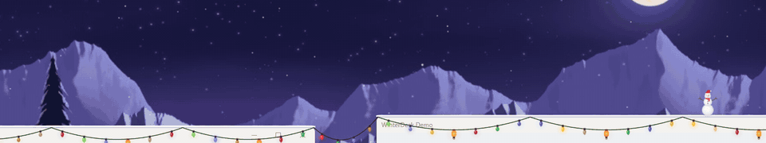
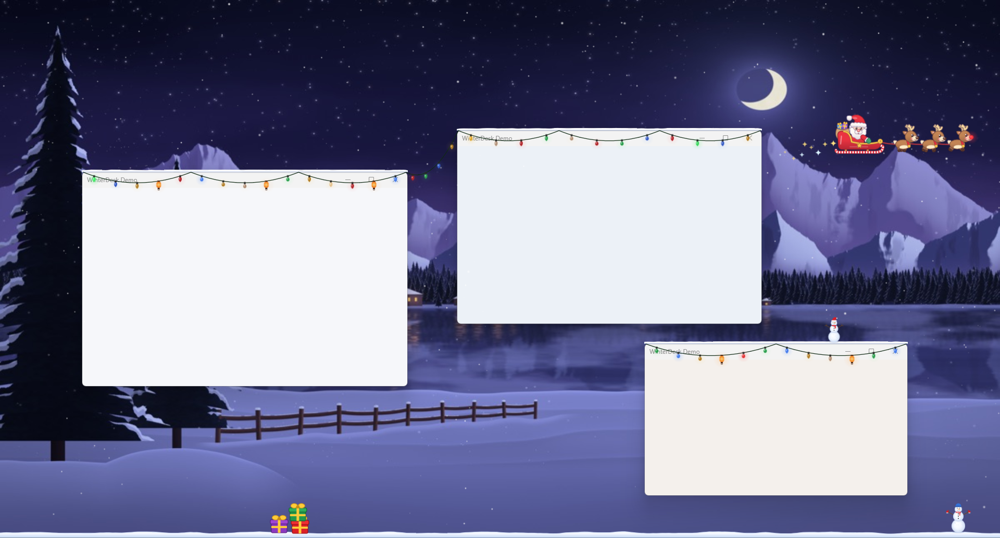
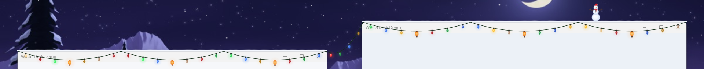
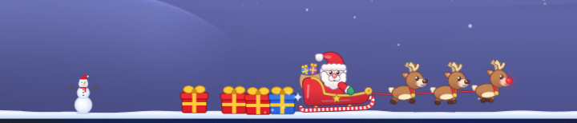
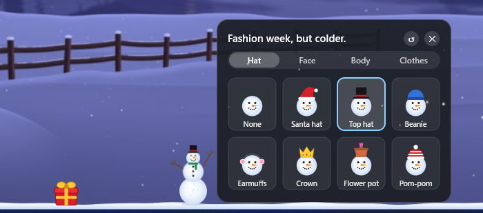
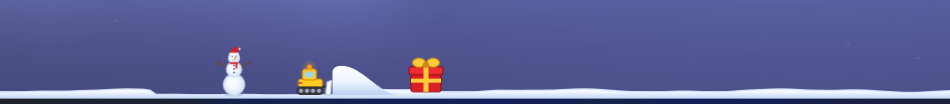
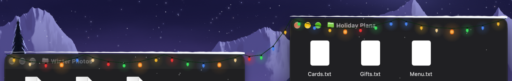

<div align="center">

# ❄️ WinterDesk

### 노트북 바탕화면에 첫눈이 내립니다

열어 둔 창 위에 소복이 쌓이는 눈, 창을 타고 다니는 눈사람,<br>
밤하늘을 가로지르는 산타와 순록, 창과 창 사이에 걸린 크리스마스 전구.




</div>



<p align="center"><sub>Windows 노트북 화면을 그대로 찍었어요. 배경은 이 저장소의 겨울 배경화면 이미지이고, 창은 내용 없는 데모 창이에요.<br>이미지 파일 없이 모든 그래픽을 코드로 그려 GPU로 렌더링합니다 (C++ · Direct3D 11 · Direct2D · DirectComposition).</sub></p>

## ✨ 이런 게 들어 있어요

| | |
|:--|:--|
| 🌨️ **창 위에 쌓이는 눈** | 열린 창마다 윗변에 눈이 조금씩 쌓입니다. 창을 끌면 눈이 창에 붙어 따라오고, 빠르게 흔들면 모래처럼 흘러내리거나 작은 눈덩이가 날아가요. |
| ⛄ **눈사람 만들기** | 작업 표시줄 위에 쌓인 눈을 끌어 눈덩이를 굴리고, 쌓아 올려 눈사람을 만들고, 모자와 목도리로 꾸며 보세요. 창 위에 올려 두면 창을 타고 다닙니다. |
| 🎅 **산타와 순록** | 썰매가 밤하늘을 가로지르며 가끔 선물을 떨어뜨리고, 작업 표시줄 눈 위에 내려앉기도 해요. 클릭하면 *Ho Ho Ho!* |
| 💡 **크리스마스 전구** | 창 윗변의 가랜드, 그리고 가까운 창과 창을 잇는 전구 줄. 원하는 창끼리 직접 이어 줄 수도 있어요. |
| 🎁 **선물 상자** | 끌어서 던지고 쌓을 수 있어요. 산타가 지나갈 때 가끔 하나씩 늘어납니다. |
| 🚜 **장난감 제설차** | 작업 표시줄 위 눈을 오가며 눈을 밀어 작은 더미를 만들어요. |
| 🛡️ **작업 방해 없음** | 클릭은 그대로 아래 창으로 통과하고, 포커스를 가져가지 않아요. 노트북 내장 화면에만 그립니다. |

---

### 🌨️ 창 위의 눈과 전구



- **창을 따라다녀요**: 창을 끌거나 크기를 바꿔도 눈과 전구가 창 가장자리에 그대로 붙어 있어요. 끄는 반대쪽으로 눈이 쏠려 끝에서 흘러내리고, 세게 흔들면 눈사람이 떨어집니다. 트레이 메뉴의 *창 끌 때 눈*에서 "미끄러져 떨어짐 / 붙어 있음"을 고를 수 있어요.
- **창이 사라지면 같이 사라져요**: 창을 닫거나 최소화하면 그 창의 눈과 전구가 바로 사라지고, 다시 열면 천천히 다시 쌓입니다. 창 위 눈사람은 창이 돌아오면 다시 올라가요.
- **가려지면 가려져요**: 다른 창이 위를 덮으면 덮인 부분의 눈과 전구는 보이지 않아요.
- **전구 직접 연결**: <kbd>Ctrl+Alt+Shift+L</kbd>을 누르면 창마다 금색 점이 나타나요. 한 창의 점을 다른 창의 점으로 끌어다 놓으면 전구 줄이 생깁니다. 편집 중에 줄을 클릭하면 지워지고, <kbd>Esc</kbd>로 끝내요.
- 창 위 눈과 전구는 **On Top 모드**에서 동작해요(기본값). 아래 [모드](#-모드-on-top--desktop) 참고.

### 🎅 산타와 선물



- 산타는 눈을 깜빡이고 손을 흔들고, 맨 앞 순록의 빨간 코가 반짝여요. 절반쯤은 작업 표시줄 눈 위에 내려앉아 미끄러지다 다시 날아오릅니다.
- 산타가 한 번 지나갈 때 선물을 떨어뜨릴 확률은 약 6.7%예요. 메뉴의 *Add Gift*로 직접 추가할 수도 있어요.
- 선물은 저절로 사라지지 않고 계속 쌓여요(최대 30개). 마우스를 올리면 나오는 ✕로 지울 수 있어요.

### ⛄ 눈사람 꾸미기



- **눈사람 만들기**: 작업 표시줄 위 눈을 클릭한 채 좌우로 끌면 눈덩이가 굴러가며 커져요. 작은 눈덩이를 큰 눈덩이 위에 놓으면 쌓입니다(최대 3단).
- **꾸미기**: 2단 이상인 눈사람을 클릭하면 *Fashion week, but colder.* 패널이 열려요. Hat · Face · Body · Clothes 탭에서 고르면 바로 적용되고, ↺로 처음으로 되돌려요.
- **창 위에 올리기**: 눈사람을 창 윗변에 놓으면 창을 따라다니고, 다음에 실행할 때도 그 창 위에 다시 서 있어요. 처음 실행하면 맨 앞 큰 창 위에 산타 모자 쓴 눈사람이 하나 서 있어요.
- **지우기**: 잠깐 마우스를 올리면 나오는 ✕, 또는 오른쪽 클릭 → 삭제.

### 🚜 제설차



- <kbd>Ctrl+Alt+Shift+P</kbd>로 켜요. 화면 끝에서 끝까지 작업 표시줄 위 눈을 밀고 다니며 작은 눈 더미를 만들어요.
- 작업 표시줄을 자동으로 숨기면 눈은 화면 맨 아래에 쌓여요.

---

## 📦 설치

> **필요한 것**: Windows 10 / 11 (x64) 노트북. 관리자 권한은 필요 없어요.

**Windows** — PowerShell에 붙여 넣으세요.

```powershell
irm https://github.com/sitdownSeungpyo/mac_snow/releases/latest/download/setup.ps1 | iex
```

**macOS** — 터미널에 붙여 넣으세요.

```bash
curl -fsSL https://github.com/sitdownSeungpyo/mac_snow/releases/latest/download/setup.sh | bash
```

이게 전부예요. 최신 릴리스를 받아 SHA256을 확인한 뒤 설치하고 바로 실행하며, **컴퓨터를 켤 때마다 자동으로 시작**됩니다. 같은 명령을 다시 실행하면 최신 버전으로 업데이트돼요(설정은 그대로).
Windows에서는 `%LOCALAPPDATA%\Programs\WinterDesk`에 설치되고 시작 메뉴에 바로 가기가 생겨요.

<details>
<summary><b>직접 내려받기</b></summary>

[Releases 페이지](https://github.com/sitdownSeungpyo/mac_snow/releases/latest)에서 받으세요.

| 파일 | 대상 |
|---|---|
| `WinterDesk-windows-x64.zip` | Windows 10 / 11 (x64). 압축을 풀고 `WinterDesk.exe` 실행 |
| `WinterDesk-macos-universal.zip` | macOS 13 이상 (Apple 실리콘 · Intel) |

서명되지 않은 개인 프로젝트 앱이라, 직접 받은 파일을 처음 열 때 Windows SmartScreen이나 macOS Gatekeeper가 경고할 수 있어요.
</details>

<details>
<summary><b>소스에서 빌드하기</b></summary>

```powershell
# Windows: Visual Studio Build Tools (C++ x64, Windows SDK) 필요
git clone https://github.com/sitdownSeungpyo/mac_snow.git
cd mac_snow
powershell -ExecutionPolicy Bypass -File windows\build.ps1   # -> windows\build\WinterDesk.exe
```

```bash
# macOS: Command Line Tools (xcode-select --install) 필요
git clone https://github.com/sitdownSeungpyo/mac_snow.git
cd mac_snow
./install.sh
```

Windows 빌드 옵션과 개발용 플래그는 [windows/README.md](windows/README.md)에 있어요.
</details>

## 🎛️ 사용법

알림 영역(트레이)의 ❄️ 아이콘을 클릭하면 모든 효과를 켜고 끌 수 있어요. 자주 쓰는 건 단축키로도 돼요.

| 단축키 | 동작 |
|:--:|:--|
| <kbd>Ctrl+Alt+Shift+Q</kbd> | 🛑 **비상 종료** (언제든 바로) |
| <kbd>Ctrl+Alt+Shift+E</kbd> | 모든 효과 켜기 / 끄기 |
| <kbd>Ctrl+Alt+Shift+S</kbd> | 눈 내리기 켜기 / 끄기 |
| <kbd>Ctrl+Alt+Shift+D</kbd> | 산타 켜기 / 끄기 |
| <kbd>Ctrl+Alt+Shift+P</kbd> | 제설차 켜기 / 끄기 |
| <kbd>Ctrl+Alt+Shift+L</kbd> | 전구 연결 편집 (<kbd>Esc</kbd>로 끝내기) |
| <kbd>Ctrl+Alt+Shift+G</kbd> | 🧾 방금 이상하게 보인 장면 기록하기 (아래 참고) |

<details>
<summary><b>트레이 메뉴 항목 전체 보기</b></summary>

| 메뉴 | 설명 |
|---|---|
| Effects On | 모든 효과 켜기/끄기 (끄면 CPU를 거의 쓰지 않아요) |
| 전구 연결하기… | 창끼리 전구 줄 직접 연결 (<kbd>Ctrl+Alt+Shift+L</kbd>) |
| Snow Falling · Snow Intensity | 눈 내리기, 눈의 양 (Light / Normal / Heavy) |
| Mode | Desktop (behind windows) / On Top (over everything) |
| Santa · 제설차 (Snowplow) | 산타, 제설차 켜기/끄기 |
| Snow on Windows · Window Lights | 창 위 눈 / 창 사이 전구 (On Top 모드) |
| 실시간 창 추적 (실험적) | 창을 끄는 동안 눈·전구가 프레임마다 창을 따라가요. 끄면 창이 멈춘 뒤 다시 쌓여요 |
| 창 끌 때 눈 | 미끄러져 떨어짐 / 붙어 있음 |
| Light Links · Window Garlands · Light Style | 자동/수동 전구 연결, 창 윗변 가랜드, Multicolor / Warm White |
| Add Gift · Clear … · Reset Snow | 선물 추가, 눈사람·눈덩이·선물 지우기, 눈 처음부터 |
| Launch at Login | 로그인할 때 자동 실행 |
| Report a Glitch | 최근 동작 기록을 파일로 저장 (<kbd>Ctrl+Alt+Shift+G</kbd>) |
| Quit WinterDesk | 종료 |
</details>

> 💡 단축키는 다른 앱이 이미 쓰고 있으면 조용히 건너뛰어요. 독일어처럼 AltGr이 있는 키보드 배열에서는 Ctrl+Alt가 AltGr과 같아서 문자 입력과 겹칠 수 있어요(한국어·영어 배열은 문제없음).

## 🪟 모드: On Top / Desktop

| 모드 | 그리는 위치 | 창 위 눈·전구 |
|---|---|:--:|
| **On Top** (기본) | 모든 창 위. 클릭은 아래 창으로 그대로 통과 | ✅ |
| **Desktop** | 앱 창 뒤, 바탕화면 아이콘 바로 위 | — |

On Top에서도 눈사람·선물·산타·제설차·전구 편집 점 위에 커서가 있을 때만 마우스를 받고, 나머지는 전부 아래 창으로 통과해요.

## 💻 노트북 내장 화면에서만

WinterDesk는 **노트북 내장 디스플레이에만** 그려요. 외부 모니터에는 절대 그리지 않아요.

- 덮개를 닫거나 외부 모니터만 쓰면 일시 정지하고, 트레이 메뉴에 "내장 디스플레이 없음 – 일시 정지"가 보여요. 내장 화면이 다시 켜지면 자동으로 이어져요.
- 내장 디스플레이가 없는 데스크톱 PC에서는 그리지 않아요.

## 🧾 이상한 장면을 봤다면

눈이 깜빡이거나, 엉뚱한 곳에 그려지거나, 늦게 사라지는 걸 봤다면 **바로 <kbd>Ctrl+Alt+Shift+G</kbd>**를 눌러 주세요(트레이 메뉴의 *Report a Glitch*도 같아요). 최근 동작 기록이 `%LOCALAPPDATA%\WinterDesk\Logs\glitch-<시각>.csv`로 저장돼요. 창 위치·크기와 눈이 쌓이고 떨어진 이벤트 같은 동작 정보만 담기고, 창 제목·키 입력·화면 내용은 담기지 않아요. 이 파일을 [이슈](https://github.com/sitdownSeungpyo/mac_snow/issues)에 첨부해 주시면 원인을 찾기가 훨씬 쉬워요.

## 🛡️ 안전 장치

화면 전체를 덮는 앱이라, 문제가 생겨도 컴퓨터를 계속 쓸 수 있게 만들었어요.

- 🛑 <kbd>Ctrl+Alt+Shift+Q</kbd>: 어떤 상황에서도 바로 종료돼요.
- 🖱️ **클릭 통과 · 포커스 없음**: 오버레이는 작업 표시줄과 Alt+Tab에 나타나지 않고, 입력 중인 창의 포커스를 빼앗지 않아요. 물체를 잡고 있다가도 마우스 버튼을 떼면 바로 놓아요.
- 🐕 **워치독**: 앱이 3초 넘게 멈추면 스스로 종료해요.
- 🩹 **안전 모드**: 직전 실행이 비정상 종료됐거나, 실행할 때 <kbd>Shift</kbd>를 누르고 있으면 Desktop 모드에 창 위 효과를 끈 채로 시작해요. 트레이 메뉴 맨 위에 ⚠️ 안내가 나오고, Mode를 직접 고르면 끝나요.
- 🔋 화면이 잠기면 쉬고, 전체 화면 앱·게임·프레젠테이션이 내장 화면에 있으면 숨고 멈춰요. 움직이는 것이 없으면 그리지 않아요.

## ⚠️ 알려진 제한

- 노트북 내장 화면 전용이에요. 외부 모니터나 데스크톱 PC에서는 동작하지 않아요(일시 정지).
- 창 위 눈과 전구는 On Top 모드에서만 보여요.
- 작업 표시줄 위 눈 띠는 다른 창과 겹치는 부분에서는 마우스를 받지 않아요(최대화된 창 아래쪽 클릭을 막지 않기 위해).
- 전구 반짝임은 CPU를 아끼려고 3단계로 초당 약 5번 바뀌어요(mac은 연속).
- Ctrl+Alt+Shift 단축키는 AltGr 키보드 배열과 겹칠 수 있어요(위 사용법 참고).

## 🗑️ 제거

**Windows** (PowerShell):

```powershell
& ([scriptblock]::Create((irm https://github.com/sitdownSeungpyo/mac_snow/releases/latest/download/setup.ps1))) -Uninstall
```

**macOS** (터미널):

```bash
curl -fsSL https://github.com/sitdownSeungpyo/mac_snow/releases/latest/download/setup.sh | bash -s -- --uninstall
```

---

## 🍎 macOS

macOS 13 이상에서도 같은 WinterDesk가 돌아가요(Swift · SpriteKit · Core Graphics). 메뉴바의 ❄️ 아이콘에서 켜고 끄고, 작업 표시줄 대신 **Dock 위**에 눈이 쌓여요.


| 단축키 | 동작 |
|:--:|:--|
| <kbd>⌃⌥⌘Q</kbd> | 🛑 비상 종료 |
| <kbd>⌃⌥⌘E</kbd> | 모든 효과 켜기 / 끄기 |
| <kbd>⌃⌥⌘S</kbd> | 눈 내리기 켜기 / 끄기 |
| <kbd>⌃⌥⌘D</kbd> | 산타 켜기 / 끄기 |
| <kbd>⌃⌥⌘L</kbd> | 전구 연결 편집 |
| <kbd>⌃⌥⌘P</kbd> | 제설차 켜기 / 끄기 |
| <kbd>⌃⌥⌘G</kbd> | 이상한 장면 기록 (`~/Library/Logs/WinterDesk/flicker-<시각>.csv`) |

<details>
<summary><b>맥 화면 더 보기</b></summary>




</details>

- **손쉬운 사용 권한(권장)**: 메뉴바 ❄️ → *Grant Accessibility*를 켜 두면 <kbd>⌘Tab</kbd>으로 앱을 바꿀 때 창 위 눈이 번쩍이지 않고, Dock 위 눈이 Dock 위치에 딱 맞게 쌓여요. 입력한 키는 읽거나 기록하지 않아요. 개인용(ad-hoc) 서명 앱이라 다시 설치하면 권한이 풀릴 수 있어요. 그럴 땐 목록에서 WinterDesk를 지우고 다시 추가해 주세요.
- **겨울 배경화면**: `./wallpaper/set_wallpaper.sh`로 코드로 그린 겨울 밤 배경화면을 적용하고, `./wallpaper/restore_wallpaper.sh`로 되돌려요.


<sub>창을 실시간으로 따라가는 데 macOS 비공개 API(SkyLight)를 써요. 쓸 수 없는 환경에서는 자동으로 기본 모드(가끔 확인하는 방식)로 동작합니다. 개발자용 상세 문서: [docs/TECHNICAL.md](docs/TECHNICAL.md) · Windows: [windows/README.md](windows/README.md)</sub>
