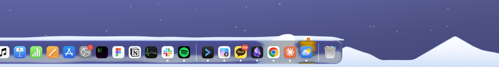

<div align="center">

# ❄️ WinterDesk

### 맥 바탕화면에 첫눈이 내립니다

열어 둔 창 위에 소복이 쌓이는 눈, 창을 타고 다니는 눈사람,<br>
밤하늘을 가로지르는 산타와 순록, 창과 창 사이에 걸린 크리스마스 전구.


</div>


<p align="center"><sub>실제 맥북 화면 그대로입니다. 이미지 파일 없이 모든 그래픽을 코드로 그려요 (Swift · SpriteKit · Core Graphics).</sub></p>

## ✨ 이런 게 들어 있어요

| | |
|:--|:--|
| 🌨️ **창 위에 쌓이는 눈** | 열린 창마다 윗변에 눈이 조금씩 쌓입니다. 창을 옮기면 눈이 창에 딱 붙어 따라오고, 창을 넓히거나 좁히면 모래처럼 밀리거나 가장자리로 흘러내려요. |
| ⛄ **눈사람 만들기** | 바닥에 쌓인 눈을 끌어 눈덩이를 굴리고, 쌓아 올려 눈사람을 만들고, 모자와 목도리로 꾸며 보세요. 창 위에 올려 두면 창을 타고 다닙니다. |
| 🎅 **산타와 순록** | 썰매가 밤하늘을 가로지르며 선물을 떨어뜨리고, 가끔 Dock 위에 내려앉아요. 클릭하면 *Ho Ho Ho!* |
| 💡 **크리스마스 전구** | 창 윗변의 가랜드, 그리고 창과 창을 잇는 전구 줄. 원하는 창끼리 직접 이어 줄 수도 있어요. |
| 🎁 **선물 상자** | 끌어서 던지고 쌓을 수 있어요. 산타가 지나갈 때 가끔 하나씩 늘어납니다. |
| 🚜 **장난감 제설차** | 바닥 눈 위를 오가며 눈을 밀어 작은 더미를 만들어요. Dock 뒤로도 지나갑니다. |
| 🏔️ **겨울 배경화면** | 코드로 그린 겨울 밤 배경화면이 함께 들어 있어요. |

---

### 🌨️ 창 위의 눈과 전구


- **창을 따라다녀요**: 창을 끌거나 크기를 바꿔도 눈과 전구가 창 가장자리에 그대로 붙어 있어요. 빠르게 끌면 눈이 뒤쪽으로 미끄러져 흘러내리고, 세게 흔들면 눈사람이 떨어집니다.
- **창이 사라지면 같이 사라져요**: 창을 닫거나, 최소화하거나, 앱을 숨기면(<kbd>⌘H</kbd>) 그 창의 눈과 전구가 바로 사라지고, 다시 열면 천천히 다시 쌓입니다.
- **가려지면 가려져요**: 다른 창이 위를 덮으면 덮인 부분의 눈은 보이지 않아요. 앱을 바꾸거나 창을 끌고 지나가도 깜빡이지 않게 다듬었어요.
- **전구 직접 연결**: <kbd>⌃⌥⌘L</kbd>을 누르면 창마다 금색 점이 나타나요. 한 창의 점을 다른 창의 점으로 끌어다 놓으면 전구 줄이 생깁니다. 편집 중에 줄을 클릭하면 지워지고, <kbd>Esc</kbd>로 끝내요.

### 🎅 산타와 선물


- 산타는 눈을 깜빡이고 손을 흔들고, 맨 앞 순록의 빨간 코가 반짝여요.
- 선물은 저절로 사라지지 않고 계속 쌓여요(최대 30개). 마우스를 올리면 나오는 ✕로 지울 수 있어요.

### ⛄ 눈사람과 🚜 제설차



- **눈사람 만들기**: 바닥(또는 Dock 위) 눈을 클릭한 채 좌우로 끌면 눈덩이가 굴러가며 커져요. 작은 눈덩이를 큰 눈덩이 위에 놓으면 쌓입니다(최대 3단).
- **꾸미기**: 2단 이상인 눈사람을 클릭하면 *Fashion week, but colder.* 패널이 열려요. 모자·얼굴·몸·옷을 골라 보세요.
- **지우기**: 잠깐 마우스를 올리면 나오는 ✕, 또는 오른쪽 클릭 → 삭제.
- **제설차**: <kbd>⌃⌥⌘P</kbd>로 켜요. 화면 끝에서 끝까지 바닥 눈을 밀고 다니며, Dock 유리 뒤로도 지나갑니다.
- **Dock 위 눈**: Dock이 숨겨지면(자동 가리기, 전체 화면 등) Dock 위에 쌓였던 눈이 바닥으로 쏟아지고, Dock이 다시 나타나면 처음부터 다시 쌓여요.

### 🏔️ 겨울 배경화면


---

## 📦 설치

> **필요한 것**: macOS 13 이상, Command Line Tools (`xcode-select --install`). Xcode 전체는 없어도 돼요.

```bash
git clone https://github.com/sitdownSeungpyo/mac_snow.git
cd mac_snow
./install.sh
```

이게 전부예요. 앱이 `~/Applications/WinterDesk.app`에 설치되어 바로 실행되고, **맥을 켤 때마다 자동으로 시작**됩니다.

<details>
<summary><b>🏔️ 배경화면 적용 / 되돌리기</b></summary>

```bash
./wallpaper/set_wallpaper.sh       # 겨울 배경화면 적용 (지금 배경화면은 백업해 둬요)
./wallpaper/restore_wallpaper.sh   # 원래 배경화면으로 되돌리기
```
</details>

### 🔐 손쉬운 사용 권한 (권장)

메뉴바 ❄️ → **Grant Accessibility (Dock snow + no ⌘Tab flash)** → *시스템 설정 › 개인정보 보호 및 보안 › 손쉬운 사용*에서 WinterDesk를 켜 주세요. 켜 두면 이렇게 좋아져요.

- <kbd>⌘Tab</kbd>으로 앱을 바꿀 때 창 위의 눈이 번쩍이지 않아요. 전환이 시작되면 잠깐 숨겼다가, 끝나면 부드럽게 다시 보여 줍니다. ⌘와 Tab을 함께 눌렀는지만 확인하고, **입력한 키는 읽거나 기록하지 않아요.**
- Dock의 정확한 위치를 알아서 Dock 위 눈이 딱 맞게 쌓이고, 전체 화면에서 Dock이 사라지면 그 위 눈이 바닥으로 쏟아집니다.

> ⚠️ 개인용(ad-hoc) 서명 앱이라 **다시 빌드하거나 설치하면 권한이 풀릴 수 있어요.** 설정에는 켜져 있는데 ⌘Tab 번쩍임이 다시 보이면, 목록에서 WinterDesk를 `−`로 지우고 `+`로 다시 추가해 켜 주세요.

## 🎛️ 사용법

메뉴바의 ❄️ 아이콘에서 모든 효과를 켜고 끌 수 있어요. 자주 쓰는 건 단축키로도 돼요.

| 단축키 | 동작 |
|:--:|:--|
| <kbd>⌃⌥⌘Q</kbd> | 🛑 **비상 종료** (언제든 바로) |
| <kbd>⌃⌥⌘E</kbd> | 모든 효과 켜기 / 끄기 |
| <kbd>⌃⌥⌘S</kbd> | 눈 내리기 켜기 / 끄기 |
| <kbd>⌃⌥⌘D</kbd> | 산타 켜기 / 끄기 |
| <kbd>⌃⌥⌘L</kbd> | 전구 연결 편집 |
| <kbd>⌃⌥⌘P</kbd> | 제설차 켜기 / 끄기 |
| <kbd>⌃⌥⌘G</kbd> | 🧾 방금 이상하게 보인 장면 기록하기 (아래 참고) |

<details>
<summary><b>메뉴 항목 전체 보기</b></summary>

| 메뉴 | 설명 |
|---|---|
| Effects On | 모든 효과 켜기/끄기 (끄면 CPU를 거의 쓰지 않아요) |
| Snow Falling · Snow Intensity | 눈 내리기, 눈의 양 (Light / Normal / Heavy) |
| Mode | Desktop(창 뒤) / On Top(창 위의 눈·전구 사용) |
| Santa · 제설차 | 산타, 제설차 켜기/끄기 |
| Snow on Windows · Window Lights · Window Garlands | 창 위 눈 / 창 사이 전구 / 창 윗변 가랜드 |
| Add Gift · Clear … · Reset Snow | 선물 추가, 눈사람·선물 지우기, 눈 처음부터 |
| Grant Accessibility | 손쉬운 사용 권한 요청 (위 참고) |
| Launch at Login | 로그인할 때 자동 실행 |
| Report a Glitch | 최근 동작 기록을 파일로 저장 (<kbd>⌃⌥⌘G</kbd>) |
</details>

> 💡 노치에 가려 ❄️ 아이콘이 안 보이면 <kbd>⌘</kbd>를 누른 채 다른 메뉴바 아이콘을 끌어 자리를 만들어 주세요. 아이콘이 안 보여도 단축키는 항상 동작해요.

## 🧾 이상한 장면을 봤다면

눈이 깜빡이거나, 엉뚱한 곳에 그려지거나, 늦게 사라지는 걸 봤다면 **바로 <kbd>⌃⌥⌘G</kbd>**를 눌러 주세요(메뉴의 *Report a Glitch*도 같아요). 최근 동작 기록이 `~/Library/Logs/WinterDesk/flicker-<시각>.csv`로 저장돼요. 창 위치·순서, 앞에 있는 앱의 번들 ID 같은 동작 정보만 담기고, 키 입력이나 화면 내용은 담기지 않아요. 이 파일을 이슈에 첨부해 주시면 원인을 찾기가 훨씬 쉬워요.

## 🛡️ 안전 장치

화면 전체를 덮는 앱이라, 문제가 생겨도 맥을 계속 쓸 수 있게 만들었어요.

- 🛑 <kbd>⌃⌥⌘Q</kbd>: 어떤 상황에서도 바로 종료돼요.
- 🐕 **워치독**: 앱이 3초 넘게 멈추면 스스로 종료해요.
- 🩹 **안전 모드**: 직전 실행이 비정상 종료됐거나, 실행할 때 <kbd>⇧</kbd>를 누르고 있으면 효과를 최소로 줄여서 시작해요.
- 🔋 화면 잠금·잠자기 중엔 쉬고, 전체 화면 앱을 쓰는 동안엔 멈추고, 배터리·저전력 모드에선 눈의 양과 프레임을 줄여요.

## 🗑️ 제거

```bash
pkill -x WinterDesk
rm -rf ~/Applications/WinterDesk.app
rm -f ~/Library/LaunchAgents/com.local.winterdesk.plist
defaults delete com.local.winterdesk
```

---

<sub>창을 실시간으로 따라가는 데 macOS 비공개 API(SkyLight)를 써요. 쓸 수 없는 환경에서는 자동으로 기본 모드(가끔 확인하는 방식)로 동작합니다. 개발자용 상세 문서: [docs/TECHNICAL.md](docs/TECHNICAL.md)</sub>
