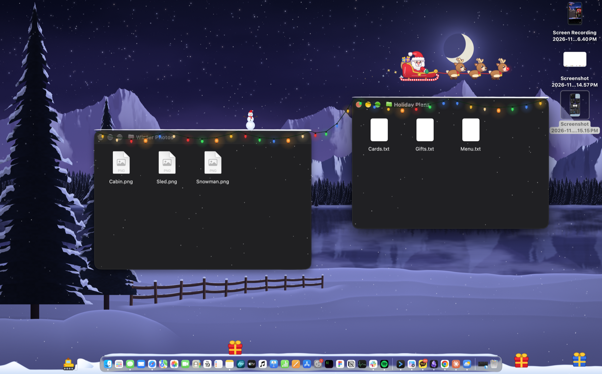

<div align="center">

# ❄️ WinterDesk

**맥 바탕화면에 첫눈이 내립니다.**

창 위에 소복이 쌓이는 눈 · 눈사람 · 산타와 순록 · 반짝이는 전구


</div>

---



<p align="center"><sub>실제 맥북 화면 캡처 — 모든 그래픽은 외부 이미지 없이 코드로 그립니다 (Swift · SpriteKit · Core Graphics)</sub></p>

## ✨ 효과 한눈에 보기

| | |
|:--|:--|
| 🌨️ **창 위에 쌓이는 눈** | 창마다 윗변에 눈이 쌓이고, 창을 움직이면 딱 붙어 부드럽게 따라옵니다. 눈은 모래처럼 흘러 창을 넓히면 밀려가고 좁히면 가장자리로 쏟아집니다. |
| ⛄ **눈사람 만들기** | 바닥 눈을 끌어 눈덩이를 굴리고, 쌓아서 눈사람을 만들고, 모자·목도리로 꾸밀 수 있어요. 창 위에 올리면 창을 타고 다닙니다. |
| 🎅 **산타와 순록** | 썰매가 하늘을 가로지르며 선물을 떨어뜨리고, 가끔 Dock 위에 내려앉습니다. 클릭하면 *Ho Ho Ho!* |
| 💡 **창 사이 전구** | 창 윗변의 가랜드와, 창과 창을 잇는 전구 줄. 금색 점을 끌어 직접 연결할 수도 있어요. |
| 🎁 **선물 상자** | 끌어서 던지고 쌓을 수 있고, 산타가 지나갈 때마다 하나씩 늘어납니다. |
| 🚜 **장난감 제설차** | 바닥 눈 위를 달리며 눈을 밀어 작은 더미를 만듭니다. |
| 🏔️ **겨울 배경화면** | 코드로 그린 겨울 밤 배경화면이 함께 들어 있어요. |

---

### 🌨️ 창 위에 쌓이는 눈 & 💡 전구


- 창을 빠르게 끌면 눈이 뒤쪽으로 미끄러져 흘러내리고, 세게 흔들면 눈가루가 흩날립니다.
- 창을 최소화하거나 숨기면(⌘H) 그 창의 눈은 바로 사라지고, 다시 열면 다시 쌓입니다.
- **전구 직접 연결**: <kbd>⌃⌥⌘L</kbd> → 창마다 금색 점이 나타나면, 한 창의 점을 다른 창의 점으로 끌어다 놓으세요. 편집 중 줄을 클릭하면 지워지고 <kbd>Esc</kbd>로 끝냅니다.

### 🎅 산타와 선물


- 산타는 눈을 깜빡이고 손을 흔들며, 맨 앞 순록의 빨간 코가 빛납니다.
- 선물은 자동으로 사라지지 않고 계속 쌓입니다(최대 30개). 마우스를 올리면 나오는 ✕로 지울 수 있어요.

### ⛄ 눈사람 · 🚜 제설차


- **눈사람 만들기**: 바닥(또는 Dock 위) 눈을 클릭한 채 좌우로 끌면 눈덩이가 굴러가며 커집니다. 작은 눈덩이를 큰 눈덩이 위에 놓으면 쌓입니다(최대 3단).
- **꾸미기**: 2단 이상 눈사람을 클릭하면 *Fashion week, but colder.* 패널이 열려 모자·얼굴·몸·옷을 고를 수 있어요.
- **지우기**: 잠깐 마우스를 올리면 나오는 ✕, 또는 오른쪽 클릭 → 삭제.

### 🏔️ 배경화면


---

## 📦 설치

> **준비물**: macOS 13 이상 · Command Line Tools (`xcode-select --install`, Xcode 전체는 필요 없어요)

```bash
git clone https://github.com/sitdownSeungpyo/mac_snow.git
cd mac_snow
./install.sh
```

끝! 앱이 `~/Applications/WinterDesk.app`에 설치되고 바로 실행되며, **맥을 켤 때마다 자동으로 시작**됩니다.

<details>
<summary><b>배경화면 적용 / 되돌리기</b></summary>

```bash
./wallpaper/set_wallpaper.sh       # 겨울 배경화면 적용 (기존 배경화면은 백업)
./wallpaper/restore_wallpaper.sh   # 원래 배경화면으로 되돌리기
```
</details>

<details>
<summary><b>권한 (선택)</b></summary>

메뉴 → **Grant Accessibility for Dock snow**로 손쉬운 사용 권한을 주면 Dock의 정확한 위치를 읽어 Dock 위 눈이 딱 맞게 쌓입니다. 허용하지 않아도 위치를 추정해서 동작합니다.
</details>

## 🎛️ 사용법

메뉴바의 ❄️ 아이콘에서 모든 효과를 켜고 끌 수 있어요.

| 단축키 | 동작 |
|:--:|:--|
| <kbd>⌃⌥⌘Q</kbd> | 🛑 **비상 종료** (언제든 즉시) |
| <kbd>⌃⌥⌘E</kbd> | 모든 효과 켜기 / 끄기 |
| <kbd>⌃⌥⌘S</kbd> | 눈 내리기 켜기 / 끄기 |
| <kbd>⌃⌥⌘D</kbd> | 산타 켜기 / 끄기 |
| <kbd>⌃⌥⌘L</kbd> | 전구 연결 편집 |
| <kbd>⌃⌥⌘P</kbd> | 제설차 켜기 / 끄기 |

<details>
<summary><b>메뉴 항목 전체 보기</b></summary>

| 메뉴 | 설명 |
|---|---|
| Effects On | 모든 효과 켜기/끄기 (끄면 CPU 사용 거의 0) |
| Snow Falling · Snow Intensity | 눈 내리기, 눈의 양 (Light / Normal / Heavy) |
| Mode | Desktop(창 뒤) / On Top(창 위 눈·전구 사용) |
| Santa | 산타 켜기/끄기 |
| Snow on Windows · Window Lights · Window Garlands | 창 위 눈 / 전구 / 가랜드 |
| Add Gift · Clear … · Reset Snow | 선물 추가, 눈사람·선물 지우기, 눈 초기화 |
| Launch at Login | 로그인 시 자동 실행 |
</details>

> 💡 노치에 가려 ❄️ 아이콘이 안 보이면 <kbd>⌘</kbd>를 누른 채 다른 메뉴바 아이콘을 끌어 자리를 만들어 주세요. 아이콘이 안 보여도 단축키는 항상 동작합니다.

## 🛡️ 안전 장치

화면 전체를 덮는 앱이라, 문제가 생겨도 맥을 계속 쓸 수 있도록 만들었어요.

- 🛑 <kbd>⌃⌥⌘Q</kbd> — 어떤 상황에서도 즉시 종료
- 🐕 **워치독** — 앱이 3초 이상 멈추면 스스로 종료
- 🩹 **안전 모드** — 직전 실행이 비정상 종료됐거나 실행할 때 <kbd>⇧</kbd>를 누르고 있으면 효과를 최소화해서 시작
- 🔋 화면 잠금·잠자기 중엔 쉬고, 전체 화면 앱 사용 중엔 멈추고, 저전력 모드에선 눈의 양과 프레임을 줄여요

## 🗑️ 제거

```bash
pkill -x WinterDesk
rm -rf ~/Applications/WinterDesk.app
rm -f ~/Library/LaunchAgents/com.local.winterdesk.plist
defaults delete com.local.winterdesk
```

---

<sub>실시간 창 추적에는 macOS 비공개 API(SkyLight)를 사용하며, 사용할 수 없으면 자동으로 기본 모드로 동작합니다. ad-hoc 서명 앱이라 다시 빌드하면 손쉬운 사용 권한을 다시 허용해야 할 수 있어요. 개발자용 상세 문서: [docs/TECHNICAL.md](docs/TECHNICAL.md)</sub>
